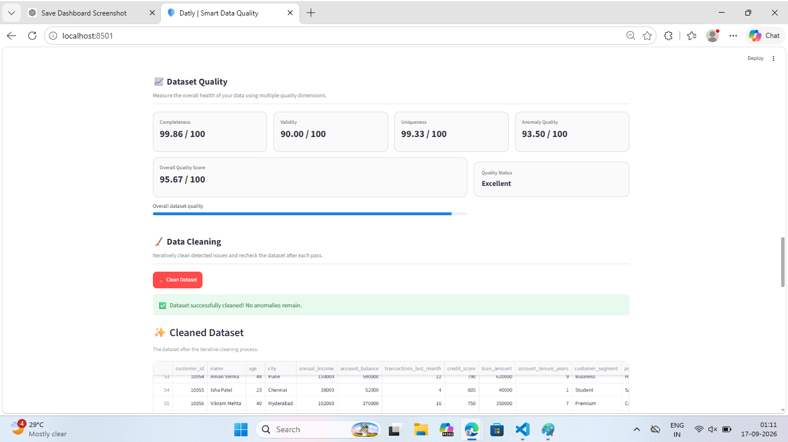

# Datly — Data Quality & Anomaly Detection Platform

Datly is a Python-based data quality platform that helps users analyze, validate, clean, and evaluate CSV datasets through an interactive Streamlit dashboard. It provides dataset profiling, data quality checks, anomaly detection, automated cleaning, quality scoring, recommendations, and report generation in one workflow.

## Dashboard Preview

![Datly Dashboard]\()

## Overview

Data quality issues such as missing values, duplicate records, invalid values, inconsistent data, and statistical outliers can affect the reliability of data analysis and decision-making.

Datly brings essential data quality operations into a single application. Users can upload a CSV dataset, inspect its structure, identify quality issues, apply cleaning operations, evaluate the resulting data quality, and review recommendations and reports.

## Features

- 📂 **CSV Dataset Upload** — Upload datasets for analysis.
- 🔍 **Dataset Profiling** — Inspect columns, data types, and dataset characteristics.
- 📊 **Data Quality Analysis** — Identify common data quality issues.
- ⚠️ **Anomaly and Outlier Detection** — Detect unusual or potentially problematic values.
- 🧹 **Automated Data Cleaning** — Handle supported data quality issues through cleaning operations.
- 🔁 **Iterative Cleaning Workflow** — Recheck data quality as cleaning progresses.
- 📈 **Quality Score Calculation** — Evaluate dataset quality using Datly's scoring logic.
- 💡 **Data Quality Recommendations** — Provide guidance based on detected issues.
- 📄 **Quality Reports** — Generate TXT and HTML reports.
- 🖥️ **Interactive Streamlit Dashboard** — Explore analysis results through the application interface.
- 👀 **Dataset Preview** — Inspect data before and after cleaning.

## How Datly Works

```text
Upload CSV
    ↓
Dataset Profiling
    ↓
Quality Checks
    ↓
Anomaly Detection
    ↓
Quality Score
    ↓
Cleaning & Validation
    ↓
Recommendations
    ↓
Quality Report
```

## Tech Stack

- **Python** — Core programming language
- **Pandas** — Data manipulation and analysis
- **Streamlit** — Interactive web application
- **HTML / CSS** — Report formatting and presentation
- **Git & GitHub** — Version control and project hosting

## Project Structure

```text
Datly/
├── app.py
├── main.py
├── requirements.txt
├── .gitignore
├── README.md
├── assets/
│   └── datly-dashboard.png
├── data/
│   └── sample CSV datasets
└── src/
    ├── anomaly_detection.py
    ├── data_cleaning.py
    ├── data_profiler.py
    ├── profiling.py
    ├── quality_checks.py
    ├── quality_report.py
    ├── quality_rules.py
    ├── quality_score.py
    └── recommendations.py
```

*Note: The structure above highlights the main project files. Your local folders may contain additional files. `app.py` is the primary Streamlit entry point.*

## Getting Started

### Prerequisites

- Python installed on your system
- Git
- A terminal or code editor, such as VS Code

### 1. Clone the repository

```bash
git clone https://github.com/satyam2004a/Datly.git
cd Datly
```

### 2. Create a virtual environment

```bash
python -m venv .venv
```

### 3. Activate the virtual environment

**Windows — PowerShell:**

```powershell
.\.venv\Scripts\Activate.ps1
```

**Windows — Command Prompt:**

```bat
.venv\Scripts\activate.bat
```

**macOS / Linux:**

```bash
source .venv/bin/activate
```

### 4. Install dependencies

```bash
python -m pip install -r requirements.txt
```

### 5. Run Datly

```bash
streamlit run app.py
```

Streamlit will provide a local URL that you can open in your browser.

## Example Workflow

1. Upload a CSV dataset.
2. Preview the uploaded data.
3. Profile columns and dataset characteristics.
4. Run data quality checks.
5. Detect anomalies and outliers.
6. Calculate the dataset quality score.
7. Apply supported cleaning operations.
8. Recheck the cleaned dataset.
9. Review data quality recommendations.
10. Generate a quality report.

## Learning Outcomes

This project provided hands-on experience with:

- Python programming and Pandas
- Data analysis and data quality engineering
- Statistical anomaly and outlier detection
- Automated data cleaning workflows
- Quality scoring and validation
- Streamlit dashboard development
- Modular software design
- Report generation and presentation
- Debugging and testing data-processing pipelines

## Future Scope

Potential future improvements include:

- Support for larger datasets
- Additional anomaly detection techniques
- More advanced statistical profiling
- Database connectivity
- Automated data quality monitoring
- Scheduled dataset validation
- API integration
- Deployment as a hosted application

## Author

**Satyam Raj**
BTech Computer Science

**GitHub:** [satyam2004a](https://github.com/satyam2004a)

---

If you find Datly interesting, feel free to explore the repository and its implementation.
